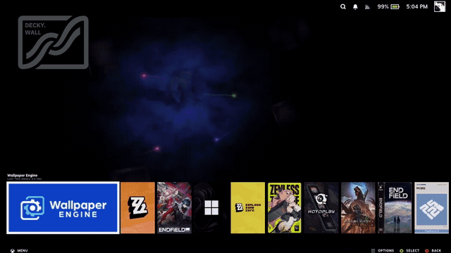
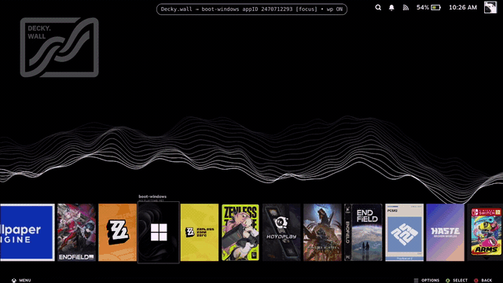

  

<h1 align="center">Decky.wall</h1>

  Your own <b>Wallpaper Engine</b> wallpapers, playing behind the Steam <b>Game Mode</b> Home screen. 
  A <a href="https://github.com/SteamDeckHomebrew/decky-loader">Decky Loader</a> plugin.

  
  
  

  <a href="#quick-start"><b>Quick start</b></a> ·
  <a href="#everyday-use"><b>Everyday use</b></a> ·
  <a href="#troubleshooting"><b>Troubleshooting</b></a> ·
  <a href="../../issues/new/choose"><b>Report a problem</b></a>

## At a glance

| | Details |
|---|---|
| **Where it plays** | Behind the Steam **Game Mode** Home screen (the gamepad UI, not the KDE desktop) |
| **Wallpapers** | 🎬 **Video**: works &nbsp;·&nbsp; 🌐 **Web**: experimental, many work &nbsp;·&nbsp; 🎨 **Scene**: not supported |
| **You need** | [Decky Loader](https://github.com/SteamDeckHomebrew/decky-loader) · Wallpaper Engine with wallpapers you own · Chrome, Edge, Brave or Vivaldi (not Firefox) |
| **Tested on** | ROG Xbox Ally X (Bazzite): by me · Steam Deck OLED: confirmed by a user · Decky for Windows: reported working by a user, untested by me |
| **Your files** | Ships no wallpapers. It only bakes ones from *your own* Workshop folder, on your own device. Open source (MIT) |

> **New in v3.2.4:** smoother moves between games: no flash of the game's own art, no flicker with per-game wallpapers, and wallpapers resume instantly. v3.2.3 added live adjusting with Quick Access open, Dim / Brightness / Zoom / Position for web wallpapers, and an **Export debug log** button. [Changelog](./CHANGELOG.md)

## Quick start

You do steps 1–3 once. After that, changing wallpaper is only step 4.

1. **Set up Decky** *(Game Mode)* 
   Install [Decky Loader](https://github.com/SteamDeckHomebrew/decky-loader#installation), then turn on **Developer mode**: **⋯ Quick Access → Decky (plug icon) → ⚙ Settings → General → Developer mode ON**.
2. **Download two files** from the [latest release](../../releases/latest)
   - `Live-Wallpaper-vX.Y.Z.zip`: the plugin
   - `video-wallpaper-selector.html`: the tool you pick wallpapers with
3. **Install the plugin** *(Game Mode)* 
   **⋯ → Decky → ⚙ Settings → Developer → Install Plugin from ZIP File** → pick the zip. *Install from the ZIP; a copied folder often won't load.*
4. **Pick a wallpaper** *(Desktop Mode)* 
   Open `video-wallpaper-selector.html` in Chrome / Edge / Brave, choose your two folders once, then click **Use this** on any wallpaper.
   

   
Where are the two folders?

   | Folder | Usual path |
   |---|---|
   | Wallpaper Engine Workshop *(read)* | `~/.local/share/Steam/steamapps/workshop/content/431960` |
   | On an SD card | `/run/media/<you>/<card>/steamapps/workshop/content/431960` |
   | Flatpak Steam | `~/.var/app/com.valvesoftware.Steam/.local/share/Steam/steamapps/workshop/content/431960` |
   | The plugin *(read/write)* | `~/homebrew/plugins/Live Wallpaper` |

   `431960` is Wallpaper Engine's Steam app ID; Steam names the folder after it. The selector remembers both folders.
   

5. **Go back to Game Mode.** The plugin reloads and your wallpaper plays behind Home. 
   Nothing showing? **⋯ → Decky → Live Wallpaper → Reload wallpaper.**

> 📺 Prefer video? **NotAGameAddict** made a full walkthrough on a Steam Deck OLED: [How to use Wallpaper Engine wallpapers in Gaming Mode](https://youtu.be/ToB_G86eptU) *(community video)*.

## Everyday use

Everything below is in **⋯ Quick Access → Live Wallpaper**. Nothing needs a re-bake.

| I want to… | Do this |
|---|---|
| Switch wallpaper without leaving Game Mode | Tap a thumbnail in the picker (wallpapers already in your library) |
| Give each game its own wallpaper | See [Per-game wallpapers](#per-game-wallpapers) |
| Use one wallpaper everywhere (smoothest) | Turn **Per-game wallpapers** off |
| Show wallpapers only on games I pick | Turn **Wallpaper on all games** off |
| Adjust the look (live, with Quick Access open) | Fit (video), Dim, Brightness, Zoom, Position X/Y, Reset position |
| Turn it off for a moment | **Enabled** toggle |
| Hide the small status readout | **Status pill** toggle |

**Adding new wallpapers** still happens on the desktop: open the selector → **Use this** (your main wallpaper) or **＋ Library** (for per-game use) → back to Game Mode.

**Desktop launcher (optional, Bazzite / SteamOS desktop):** download [`decky-wall-desktop.zip`](../../releases/latest/download/decky-wall-desktop.zip), extract it, put `decky-wall.desktop` on your Desktop and make it executable (right-click → Properties → Permissions → *Is executable*). One click opens the latest selector in Chrome / Brave / Edge; the first click also adds Decky.wall to your app menu with its icon. Right-click it for What's new, Get the latest version and Report a problem.

## Per-game wallpapers

1. In the selector, click **＋ Library** on each wallpaper you want available.
2. In Game Mode, highlight a game → **Live Wallpaper → Wallpaper for this game** → pick one, **Default**, or **Off**.
3. Scroll Home; the background follows the highlighted game.

Library wallpapers live in the plugin folder (`dist/wp/`) and stream locally, so even big videos start fast. **Reset per-game assignments** clears everything if things get stuck.

## Troubleshooting

<b>The Decky icon vanished after switching Desktop ↔ Game Mode a few times</b>

A [known Decky Loader bug](https://github.com/SteamDeckHomebrew/decky-loader/issues/799) with reloading plugins; it happens with any plugin, even with this one painting nothing. Restart Steam (**Steam → Power → Restart**) or run `sudo systemctl restart plugin_loader`. If you re-bake several times in a row, restart Steam between bakes.

<b>No wallpaper shows</b>

First time? Make sure you clicked **Use this** in the selector: **＋ Library** only adds a wallpaper to the per-game list and doesn't set your main one. Then open **Live Wallpaper → Reload wallpaper**, check **Enabled** is on, and, if you turned **Wallpaper on all games** off, that this game has a wallpaper picked. Still nothing? Tap **Export debug log** in Quick Access and [report it](../../issues/new?template=bug_report.yml) with `decky-wall-log.txt` from your Desktop.

<b>Game art flashes black when moving right on Home</b>

That comes from the CSS Loader theme **Art Hero** with *Hero Appearance → No Hero*. Pick another Hero Appearance (for example Full Screen Hero or Wide Hero). It also happens with this plugin turned off.

<b>A web wallpaper looks wrong or stays black</b>

Web support is experimental: some wallpapers rely on Wallpaper Engine features a browser doesn't have. Try **Customize** in the selector, or pick a video wallpaper.

<b>The Wallpaper Engine tile itself never gets a wallpaper</b>

Expected. Wallpaper Engine is an app, not a game, so its tile has no background layer to sit behind. Every real game works normally.

<b>Do I need this or the KDE Wallpaper Engine plugin?</b>

[`catsout/wallpaper-engine-kde-plugin`](https://github.com/catsout/wallpaper-engine-kde-plugin) does the **KDE desktop**; Decky.wall does **Game Mode**. They work side by side.

## Feedback & testing

Found a bug, have an idea, or just want to say it works on your device? **[Open an issue](../../issues/new/choose)**: there are short forms for bugs, ideas and general feedback. Reports from Steam Deck LCD, Legion Go and other handhelds are especially welcome.

---

<a href="./CHANGELOG.md">Changelog</a> · MIT License · Made by <a href="https://github.com/seatann-dev">seatann-dev</a>

